# Orvyqmedia Cold-Calling Tracker

[](https://web-iota-one-57.vercel.app)
[](https://flutter.dev)
[](https://nextjs.org)
[](https://supabase.com)
[](https://vitest.dev)
[](#)

Free, zero-telephony-overhead cold-calling accountability platform and verification engine for **Orvyqmedia**. 

Employees call assigned business prospects directly from their personal mobile carriers. On Android, a companion Flutter app verifies outgoing calls by reading the device call log, filters numbers strictly on-device to protect worker privacy, enforces a **Call Lock** until post-call outcomes are recorded, and uploads verified proofs to Supabase. For **iOS and Safari users**, a dedicated **Progressive Web App (PWA)** provides the identical lead queue, native `tel:` dialer integration, live in-call stopwatches, pitch cheat sheets, and disposition sheets. Owners monitor team shifts, assign leads, inspect talk times, and moderate team chat via the Next.js production web portal.

---

## 🌐 Live Production Deployments & Access

| Component | Platform | Live URL / Release Artifact | Target Users |
| :--- | :--- | :--- | :--- |
| **Owner Admin Portal** | Next.js 15 / Vercel | [https://web-iota-one-57.vercel.app](https://web-iota-one-57.vercel.app) | Administrators & Managers |
| **iOS / Mobile Caller App** | Progressive Web App | [https://web-iota-one-57.vercel.app/caller](https://web-iota-one-57.vercel.app/caller) | iPhone, iPad & Mobile Web Callers |
| **Android Release APK** | Flutter Native APK | [`caller-app-release.apk`](caller-app-release.apk) (59.0 MB) | Android Telecallers |
| **GitHub Repository** | GitHub | [https://github.com/ekanth14/call-tracker-for-orvyq-media](https://github.com/ekanth14/call-tracker-for-orvyq-media) | Open Source / Internal Source |

---

## 📸 Visuals & Application Walkthrough

### 1. Android Caller App Experience

| Shift Clock-In & Privacy Notice | Lead Queue & Daily Quota | Work Shift Active (On Duty) |
| :---: | :---: | :---: |
| 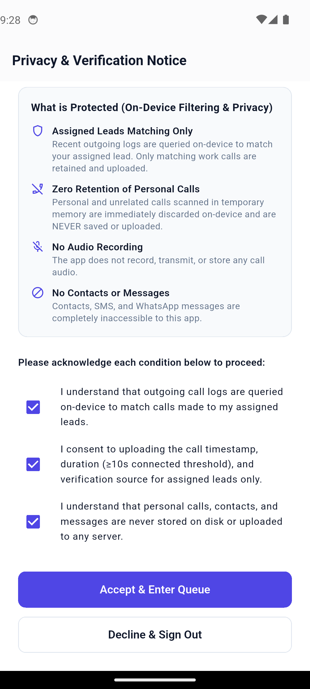 | 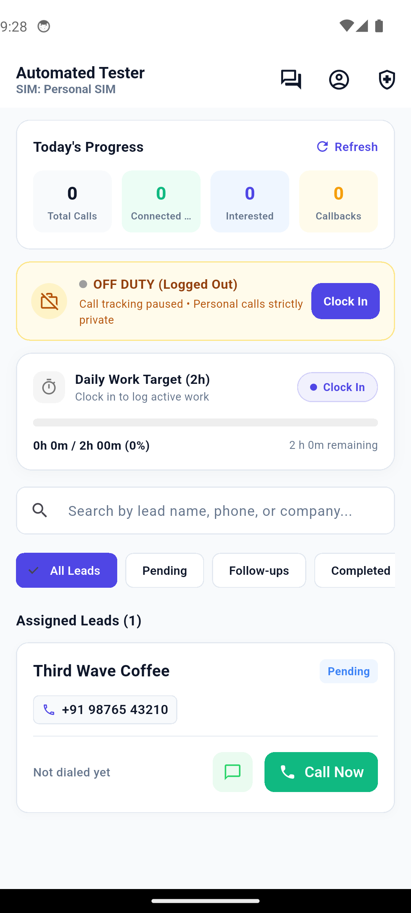 | 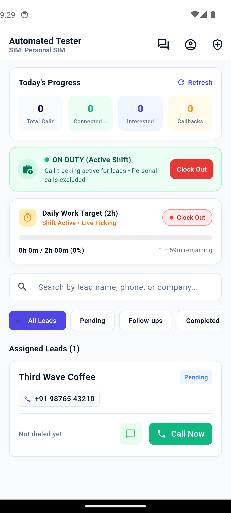 |
| *Mandatory on-device filtering consent terms.* | *Assigned leads with local timezone & quota.* | *Emerald badge confirms active work period.* |

| Native Dialer Intent & Call Lock | Post-Call Verification Stopwatch | Disposition Outcome Selection |
| :---: | :---: | :---: |
| 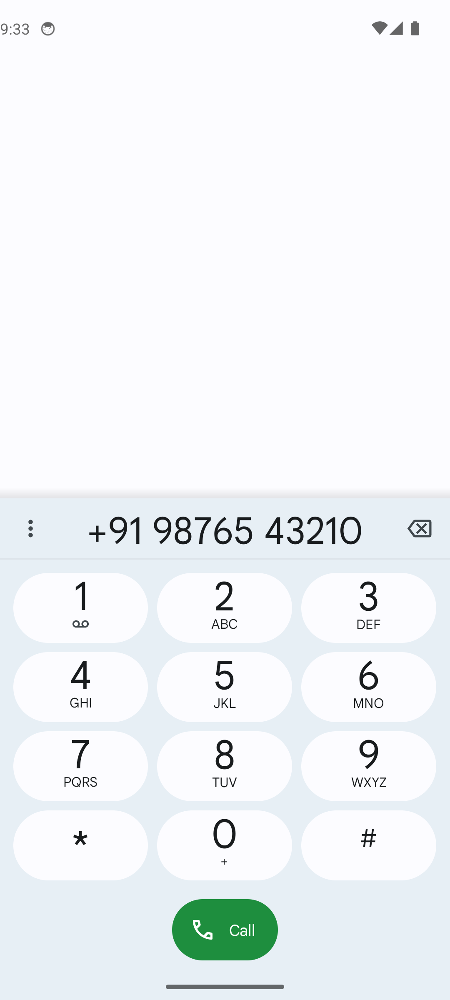 | 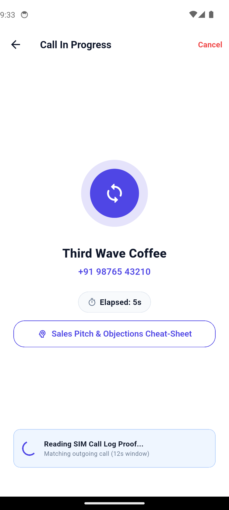 | 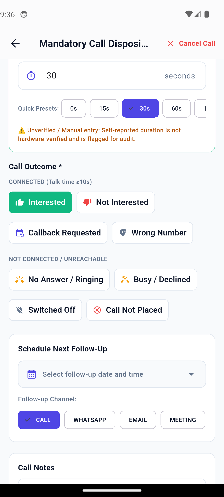 |
| *Queue locks while dialing to prevent skips.* | *Auto-matching against device call log.* | *Preset durations & reason tagging.* |

| Unlocked Lead Queue | Privacy Guard (Off-Duty Call Blocked) | Real-time Team Chat |
| :---: | :---: | :---: |
| 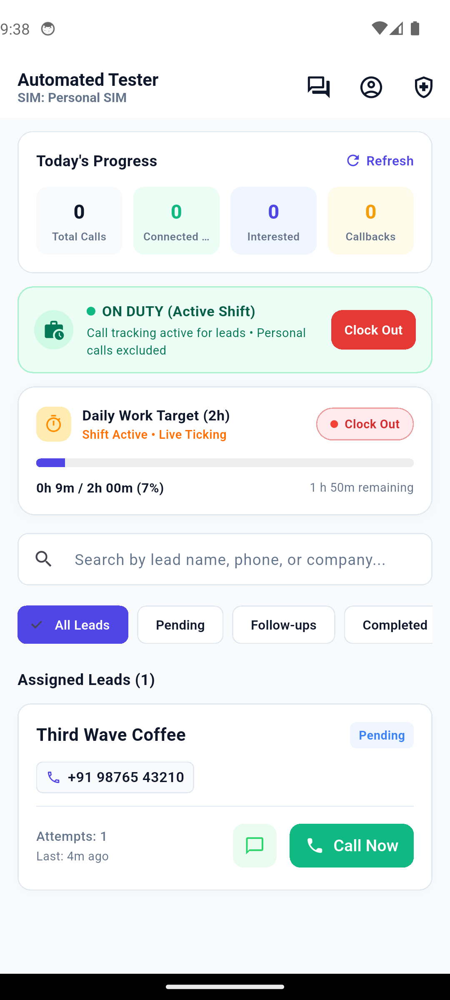 | 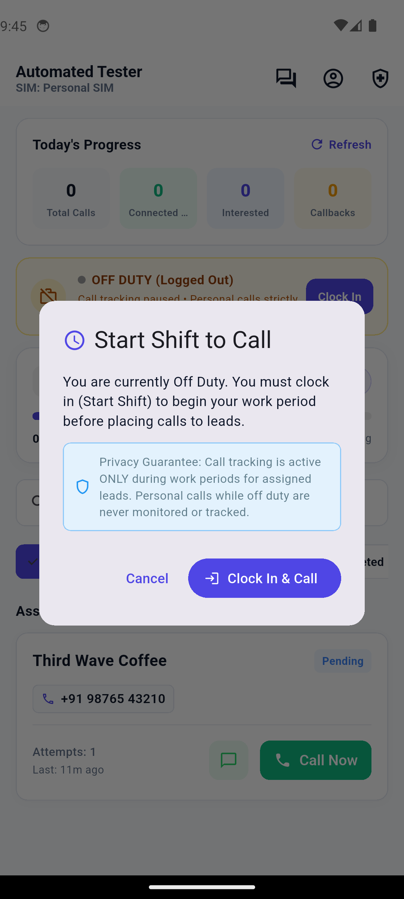 | 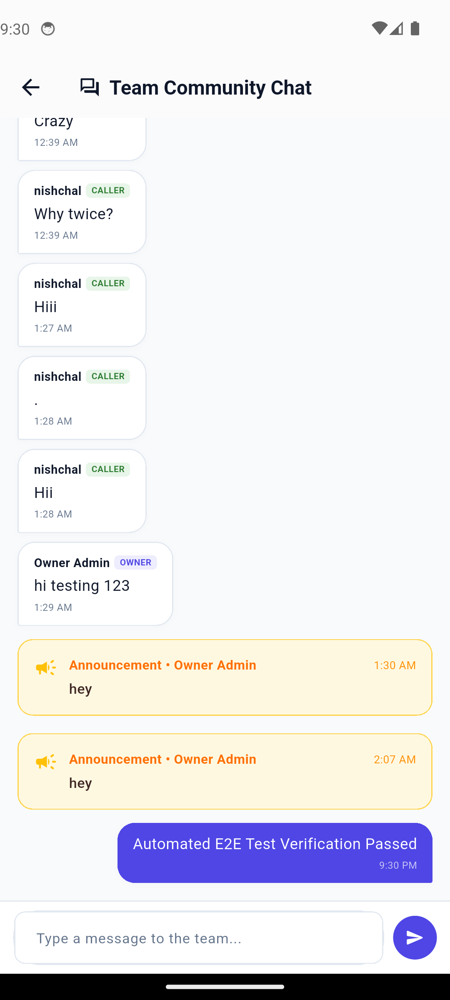 |
| *Lead status updated; next lead ready.* | *Guarantees personal calls are never logged.* | *Team discussions with role badges.* |

---

### 2. Owner Web Dashboard & iOS PWA Interface

| Desktop Owner Portal (`/login`) | iOS Mobile PWA Screen (`/caller`) |
| :---: | :---: |
| 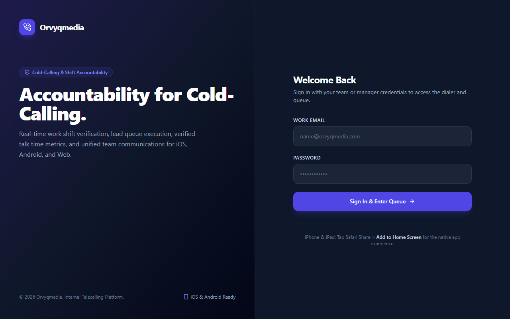 | 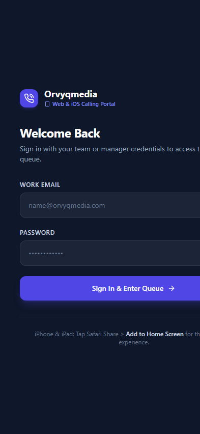 |
| *Centralized management dashboard for owners and managers.* | *Optimized for Safari "Add to Home Screen" with notch safe-area support.* |

---

## 🏛️ System Architecture

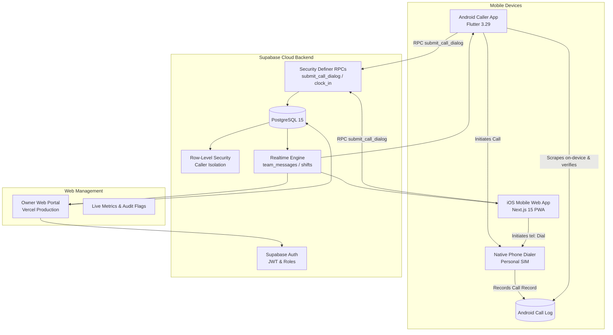

---

## 🔑 Core Integrity & Privacy Guardrails

1. **Strict Work Period Enforcement:**
   - Callers cannot initiate dial attempts or submit call records unless actively clocked in.
   - Calling while off duty is intercepted by the **Privacy Guard Modal**, guaranteeing that personal calls are never logged or uploaded.
2. **Device Call Log Verification (Android):**
   - Outgoing call proof is derived directly from the phone's native telephony log. Numbers are filtered strictly on-device to match assigned lead hashes.
3. **10-Second Connected Threshold:**
   - Outgoing calls with duration $\ge 10$ seconds are automatically classified as **Connected**. Shorter calls are treated as unverified or unanswered.
4. **Call Lock Mechanism:**
   - Initiating a call locks the caller's queue. No subsequent leads can be dialed until the post-call disposition dialog is completed.
5. **Row-Level Security (RLS) Isolation:**
   - Telecallers only see leads assigned directly to their account (`assigned_to = auth.uid()`). Callers cannot delete or modify leads, calls, or other callers' team messages.
6. **Immutable Disposition Audit Log:**
   - Once submitted, post-call dispositions cannot be deleted or manipulated.
7. **Apple iOS PWA Optimization:**
   - Standalone manifest (`manifest.webmanifest`), Apple web app capable headers, touch feedback, and safe-area padding for notched iPhones and iPads.

---

## 📂 Repository Directory Layout

```text
call-tracker-for-orvyq-media/
├── apps/
│   ├── caller_app/                      # Android Flutter application
│   │   ├── lib/
│   │   │   ├── core/                    # App config, themes, phone formatting
│   │   │   ├── data/
│   │   │   │   ├── models/              # Lead, dial attempt, stats, profile models
│   │   │   │   ├── repositories/        # Calling, lead, auth, reason repositories
│   │   │   │   └── services/            # CallLogService, background sync, permissions
│   │   │   └── ui/
│   │   │       ├── views/               # Queue, active calling, post-call dialog, chat
│   │   │       └── view_models/         # CallingViewModel, QueueViewModel, StatsViewModel
│   │   └── test/                        # Flutter navigation, verification, and chat tests
│   │
│   └── web/                             # Next.js 15 Owner Portal & iOS Caller PWA
│       ├── public/
│       │   ├── manifest.webmanifest     # PWA manifest for iOS Home Screen
│       │   └── icon.svg                 # App icon
│       ├── src/
│       │   ├── app/
│       │   │   ├── (auth)/login/        # Dual-role authentication page
│       │   │   ├── (dashboard)/         # Owner views (overview, leads, callers, calls, flags, chat)
│       │   │   ├── caller/              # Mobile-first iOS Caller PWA interface
│       │   │   └── api/                 # Secure administrative API endpoints
│       │   ├── lib/                     # E.164 phone formatting & Supabase clients
│       │   └── types/                   # Database TypeScript interfaces
│       └── tests/                       # Vitest suite (24 unit tests)
│
├── docs/
│   ├── ORVYQ_MEDIA_CALLER.md            # Comprehensive system & QA test report
│   ├── EMPLOYEE_CONSENT_FORM.md         # Worker privacy policy & consent terms
│   └── assets/screenshots/              # Visual screenshots for README & docs
│
├── supabase/
│   ├── combined_migrations.sql          # Single consolidated SQL schema
│   ├── migrations/                      # Incremental SQL migrations (20261017 - 20261020)
│   └── tests/                           # PostgreSQL RLS & security test suite
│
├── caller-app-release.apk               # Verified production Android APK
├── package.json                         # Monorepo scripts
└── README.md
```

---

## 🚀 Getting Started

### 1. Prerequisites
- **Node.js**: v18.0 or later (v20+ recommended)
- **Flutter SDK**: v3.29.0 or later (for mobile development)
- **Android SDK & Build Tools**: API 34+
- **Supabase Account**: Free project created on [supabase.com](https://supabase.com)

---

### 2. Environment Variables

Create `.env.local` inside `apps/web/`:

```ini
NEXT_PUBLIC_SUPABASE_URL=https://your-project-ref.supabase.co
NEXT_PUBLIC_SUPABASE_ANON_KEY=eyJhbGciOiJIUzI1NiIsInR5cCI6IkpXVCJ9...
SUPABASE_SERVICE_ROLE_KEY=eyJhbGciOiJIUzI1NiIsInR5cCI6IkpXVCJ9...

NEXT_PUBLIC_DEFAULT_COUNTRY=IN
NEXT_PUBLIC_MIN_CONNECTED_DURATION_SECS=10
```

---

### 3. Database Migration Setup

Apply all schemas, RLS rules, and RPC functions in one step:
1. Open the **SQL Editor** in your Supabase project dashboard.
2. Copy the entire contents of [`supabase/combined_migrations.sql`](supabase/combined_migrations.sql).
3. Paste and click **Run**.

---

### 4. Running the Web Portal & iOS PWA Locally

```bash
cd apps/web
npm install
npm run dev
```

Visit `http://localhost:3000` to test the owner dashboard, or `http://localhost:3000/caller` to test the iOS mobile caller interface.

---

### 5. Running the Android Flutter App

```bash
cd apps/caller_app
flutter pub get
flutter run
```

To build a standalone production release APK:

```bash
flutter build apk --release
```

---

### 6. Automated Testing Suites

```bash
# Run Web & iOS Caller Unit Tests (Vitest)
npm --prefix apps/web test

# Run Flutter Unit & Integration Tests
cd apps/caller_app && flutter test
```

- **Web Portal Tests (24/24 passing):** Phone normalization, minimum connected duration thresholds, outcome mappings, quota progress calculations, and chat moderation.
- **Flutter Mobile Tests (37/37 passing):** Shift state tickers, on-device call log matching, offline sync enqueuing, and chat deduplication.

---

## 👥 Demo Test Accounts

| Account | Email | Password | Role | Primary Interface |
| :--- | :--- | :--- | :--- | :--- |
| **Admin Owner** | `owner@orvyqmedia.com` | `OrvyqSecure2026!` | `owner` | Owner Desktop Dashboard (`/`) |
| **Telecaller** | `ekanthbs@orvyqmedia.com` | `OrvyqCaller2026!` | `caller` | iOS PWA (`/caller`) & Android APK |

---

## 📄 License & Disclaimer

Proprietary software developed for **Orvyqmedia**. All rights reserved. Designed to ensure ethical cold-calling compliance, data privacy, and work shift accountability.
