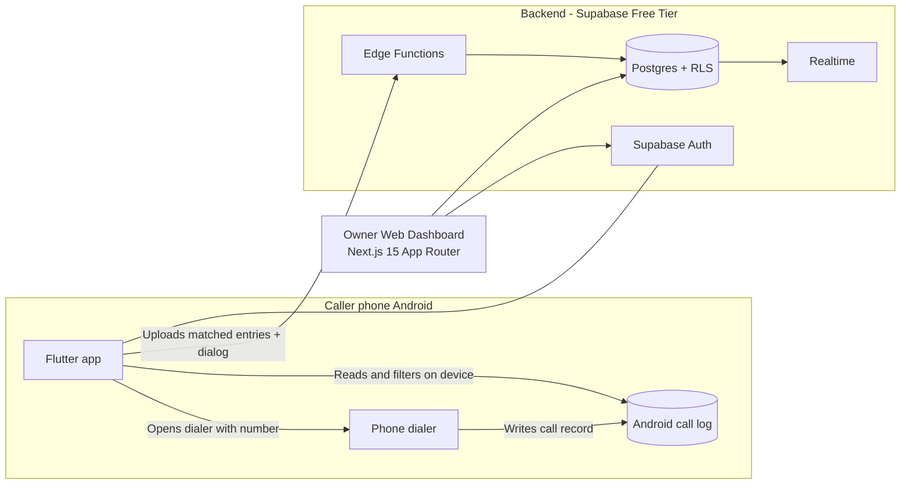

# Orvyqmedia Cold-Calling Tracker

Free, Android-first cold-calling tracker and call-log verification system for **Orvyqmedia**. 

Employees call assigned business leads directly from their personal SIMs on Android phones. A companion Flutter app verifies outgoing calls by reading the device call log, filters numbers strictly on-device to protect employee privacy, enforces a **Call Lock** until a post-call outcome dialog is recorded, and uploads the verified proof to Supabase. The owner monitors team activity, manages leads, and inspects calls via the Next.js web dashboard.

---

## Architecture Overview



### Core Integrity & Business Rules
1. **Free Tier Only:** Zero telephony costs, zero third-party bridge minutes, and zero paid webhooks.
2. **Device Call Log Verification:** Proof of calling is derived directly from the phone's call log.
3. **10-Second Connected Threshold:** Calls with an outgoing duration $\ge 10$ seconds are automatically classified as **Connected**. Calls under 10 seconds or unanswered are classified as **Not Connected**.
4. **Call Lock:** While a caller has an open dial attempt awaiting a post-call dialog submission, they cannot start any other call.
5. **Strict Caller Isolation (RLS):** Callers can only view leads assigned to them. Callers cannot write directly to `calls`, `device_call_log_entries`, `dispositions`, or `audit_log`.
6. **Immutable Dispositions:** Once submitted, call outcomes and reasons cannot be edited or deleted.

---

## Repository Structure

```text
call-tracker-orvyqmedia/
├── docs/
│   ├── ARCHITECTURE.md                  # Main system specification
│   └── ANDROID_FIRST_ADDENDUM.md        # Android-first overrides & rules
├── supabase/
│   ├── config.toml                      # Supabase CLI configuration
│   ├── combined_migrations.sql          # All migrations in 1 file for Supabase SQL Editor
│   ├── migrations/
│   │   ├── 20261017000001_initial_schema.sql         # Core schema & constraints
│   │   ├── 20261017000002_row_level_security.sql     # Strict RLS isolation policies
│   │   ├── 20261017000003_seed_reasons.sql           # Default outcomes and 10s settings
│   │   └── 20261017000004_functions_and_triggers.sql # RPCs for call lock & submissions
│   ├── tests/
│   │   └── rls_caller_isolation.test.ts # Automated RLS test suite
│   └── functions/                       # Supabase Edge Functions (Extension points for Phase 2)
│       ├── submit-dial-attempt/         # Call lock enforcement endpoint
│       └── submit-call-dialog/          # Atomic log + dialog submission endpoint
├── apps/
│   └── web/                             # Owner Dashboard (Next.js 15 App Router + Tailwind)
│       ├── src/
│       │   ├── app/
│       │   │   ├── (auth)/login/        # Owner login page
│       │   │   ├── (dashboard)/
│       │   │   │   ├── page.tsx         # Overview metrics & stats
│       │   │   │   ├── leads/           # CSV/Paste import & even-split assignment
│       │   │   │   ├── callers/         # Caller account provisioning
│       │   │   │   └── calls/           # Real-time call log table
│       │   │   └── api/
│       │   │       ├── callers/route.ts # Privileged caller creation
│       │   │       ├── leads/import/    # E.164 normalization & deduplication
│       │   │       └── leads/assign/    # Single, bulk, and even-split logic
│       │   ├── lib/
│       │   │   ├── phone.ts             # E.164 normalization engine (India default +91)
│       │   │   └── supabase/            # Browser, Server, and Admin client wrappers
│       │   └── types/database.ts        # Database schema TypeScript types
│       └── tests/
│           └── phone.test.ts            # E.164 normalization unit tests
├── scripts/
│   └── create-owner.ts                  # CLI script to bootstrap the first owner account
├── .env.example                         # Environment variables template
├── package.json                         # Workspace scripts
└── README.md
```

---

## Getting Started

### 1. Prerequisites
- **Node.js**: v18 or later (v20+ recommended)
- **Supabase Account**: Free project created on [supabase.com](https://supabase.com)

---

### 2. Environment Configuration
Create a `.env.local` file in the root directory:

```bash
cp .env.example .env.local
```

Fill in your project credentials from the **Supabase Dashboard** (`Project Settings -> API`):

```ini
NEXT_PUBLIC_SUPABASE_URL=https://your-project-ref.supabase.co
NEXT_PUBLIC_SUPABASE_ANON_KEY=eyJhbGciOiJIUzI1NiIsInR5cCI6IkpXVCJ9...
SUPABASE_SERVICE_ROLE_KEY=eyJhbGciOiJIUzI1NiIsInR5cCI6IkpXVCJ9...

NEXT_PUBLIC_DEFAULT_COUNTRY=IN
NEXT_PUBLIC_MIN_CONNECTED_DURATION_SECS=10
```

---

### 3. Database Migrations Setup

You can apply the migrations using either the **Supabase Dashboard** (quickest) or the **Supabase CLI**:

#### Option A: Via Supabase Dashboard (Recommended)
1. Open your Supabase project dashboard.
2. Go to the **SQL Editor** in the left sidebar.
3. Open `supabase/combined_migrations.sql` in this repo, copy all its contents, paste them into the SQL Editor, and click **Run**.
4. This will create all tables, enums, triggers, RLS policies, default reasons, and RPC functions in a single transaction.

#### Option B: Via Supabase CLI
```bash
# Link project
npx supabase link --project-ref your-project-ref

# Push migrations
npx supabase db push
```

---

### 4. Create the First Owner Account
Run the bootstrapping script to create the initial admin/owner user in Supabase Auth and configure their role in `profiles`:

```bash
npm run create-owner -- --email=owner@orvyqmedia.com --password=YourSecurePassword123! --name="Admin Owner"
```

---

### 5. Run the Owner Web Dashboard
Start the development server:

```bash
npm run dev
```

Open [http://localhost:3000](http://localhost:3000) in your browser:
- Log in using your owner email and password.
- **Import Leads (`/leads`)**: Upload a CSV or paste phone numbers. The system normalizes Indian mobile numbers automatically (e.g. `9876543210`, `09876543210` $\rightarrow$ `+919876543210`).
- **Create Callers (`/callers`)**: Add accounts for employees.
- **Assign Leads**: Select leads and click **Even Split** to distribute contacts evenly across callers.
- **Inspect Calls (`/calls`)**: View real-time call logs and verification outcomes.

---

### 6. Running Tests

Run the unit tests (Phone normalisation and RLS tests):

```bash
npm test
```

- **Phone Normalization Unit Tests**: `npm run test:phone` verifies standard Indian 10-digit formats, trunk prefixes (`0`), country code prefixes (`91`, `+91`), dashes/spaces, and invalid number rejections.
- **RLS Isolation Test Suite**: Verifies that callers cannot query other callers' leads, cannot insert directly into protected tables, and that owner access is uninhibited.

---

## Phase 2 (Flutter App) Extension Points

The backend has been designed with clean extension points for the Android Flutter app:

1. **Authentication:** Callers log in using email/password or OTP via the standard Supabase Flutter client.
2. **Queue Retrieval:** Callers fetch assigned leads via `supabase.from('leads').select()`. RLS automatically filters only leads where `assigned_to = auth.uid()`.
3. **Dial Attempt (`submit-dial-attempt`):** When the caller taps **Call**, the app calls the `start_dial_attempt` RPC or Edge Function to enforce the call lock and register the start time before launching the dialer.
4. **Call Log Matching:** On returning to the app, the Flutter app reads the newest outgoing entry in `CallLog` matching the lead's number.
5. **Call Dialog Submission (`submit-call-dialog`):** The app uploads the matched log entry alongside the dialog responses to `submit_call_dialog`. The server validates duration, marks the call closed, updates lead status, records the immutable disposition, and raises flags if any discrepancy exists.
