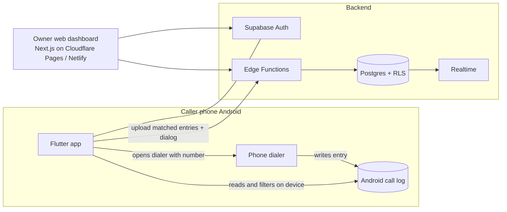

# Android-First Free Build: Addendum to ARCHITECTURE.md

**Status:** Overrides the main architecture document wherever they conflict.
**Date:** 17 October 2026

## 1. Decisions

| Topic | Decision |
|---|---|
| Platform order | Android first, iOS later |
| Cost | Everything free: no paid telephony, no paid hosting |
| Calling | Employees call from their **personal SIM**, directly from the phone (no bridge calling in this phase) |
| Proof of calls | The phone's own **call log**, read by the Android app and uploaded |
| Caller app | Native Android app built with **Flutter**, installed as an APK (no Play Store) |
| Owner interface | Web dashboard (Next.js), hosted free |
| Backend | Supabase free tier, or self-hosted on the home server |
| Post-call dialog | Still mandatory, with interested / not interested and reasons |

## 2. What changes from the main document

| Main document | In this build |
|---|---|
| Caller PWA | Replaced by the Flutter Android app (the PWA is not needed for Android) |
| Bridge calling via Exotel/Knowlarity (sections 6, 7, 9.1) | **Not used.** The `TelephonyProvider` adapter stays in the design for later, but no provider is built |
| `FakeProvider`, webhooks, reconciliation job | **Skipped for now** |
| Call state machine (7.1) | Replaced by the simpler device-log lifecycle in section 5 below |
| Proof = provider record | Proof = call-log entry from the caller's phone |
| Call recording | Not available |
| Everything else (roles, leads, dispositions, reasons, flags, dashboard, security, compliance) | Unchanged unless noted below |

## 3. Architecture

## 4. Android app

### 4.1 Technology
- Flutter (Android target only for now).
- Packages: Supabase client, a call-log reader plugin, a phone-state plugin, WorkManager for background sync, secure storage for the session.
- Permissions: `READ_CALL_LOG`, `READ_PHONE_STATE`, `CALL_PHONE` (or open the dialer with the number and let the caller press call), `POST_NOTIFICATIONS`, and a request to ignore battery optimisation.
- Distribution: signed APK shared by private link. Employees allow installation from that source. Google Play restricts call-log permission for normal apps, so Play Store distribution is not planned.

### 4.2 Screens
1. Login and **consent screen** (explains exactly what is read and what is uploaded).
2. Queue: assigned leads with a Call button.
3. Calling state: shown while waiting for the call to finish.
4. **Mandatory post-call dialog.**
5. Today's stats and follow-ups.
6. Permission and health check (shows if call-log access, battery exemption or sync is broken).

## 5. Call lifecycle (device-log based)

1. Caller taps **Call** on a lead. The app records a `dial_attempt` (lead, time) on the server and opens the phone dialer with the number.
2. Caller makes the call from their SIM and returns to the app when finished.
3. On return (and via the phone-state listener), the app reads the call log and looks for the newest **outgoing** entry for that number after the dial time. It retries for a few seconds because some phones write the entry late.
4. The app shows the **mandatory dialog** with the call-log facts (duration, time) filled in read-only.
5. On submit, the app uploads the matched log entry and the dialog together. The server links them to the `dial_attempt` and closes it.
6. **Call lock:** the app and the server both refuse a new dial attempt while a previous one has no submitted dialog.

### 5.1 Connected or not
- Outgoing entry with duration above the configured minimum (for example 10 seconds) = **connected**.
- Duration zero or below the minimum = **not connected**; the caller can only choose a not-connected reason.
- No matching log entry after the retry window = **no call detected**; the caller can retry or submit as "call not placed". It is flagged for review.

### 5.2 Background sync
- A periodic WorkManager job uploads any unsent matched entries even if the app is closed.
- Android phones from some manufacturers aggressively stop background apps. The app's health check guides each employee through the battery and auto-start settings for their phone.

## 6. Privacy rules (must-have)

- **Filtering happens on the phone.** The app only uploads log entries whose number matches a lead currently assigned to that caller. Personal calls are never uploaded.
- The app never reads contacts, messages or recordings.
- Employees sign a written consent before installing (purpose: verifying work calls on their phone).
- The consent screen in the app lists exactly what is read and uploaded.
- Owner and callers can see which entries were uploaded for each call.
- Define retention (for example delete device-log data after a set period) and a process to delete an employee's data when they leave.

## 7. Data model changes

Add or change these in the section 8 schema of the main document.

**`devices`**
| Column | Type | Notes |
|---|---|---|
| profile_id | uuid | |
| device_label | text | e.g. phone model |
| app_version | text | |
| last_sync_at | timestamptz | |
| permissions_ok | boolean | call-log and battery status reported by the app |

**`dial_attempts`**
| Column | Type | Notes |
|---|---|---|
| lead_id, caller_id, device_id | uuid | |
| dialed_at | timestamptz | server time of the Call tap |
| status | enum | `open`, `matched`, `no_call_detected`, `closed` |

**`device_call_log_entries`** (append-only)
| Column | Type | Notes |
|---|---|---|
| dial_attempt_id | uuid null | |
| device_id | uuid | |
| number_e164 | text | |
| call_type | enum | `outgoing`, `incoming`, `missed` |
| started_at | timestamptz | from the phone's call log |
| duration_secs | int | |
| sim_slot | text null | if available |
| uploaded_at | timestamptz | server time |
| clock_skew_secs | int | difference between phone time and server time at upload |
| dedupe_key | text | unique: device + number + started_at + duration |

**`calls`**: keep the table but add `source` (`device_log` now, `provider` later) and make provider columns nullable. Each call links to one `device_call_log_entries` row.

**`dispositions`**: unchanged. `connected` is stored as the system's finding, and the caller's claim is compared against it.

## 8. Verification and flag rules (updates)

Keep the rules from the main document, but replace the provider-based ones:

| Code | Rule | Severity |
|---|---|---|
| `NO_LOG_ENTRY` | Dialog submitted without a matching call-log entry | high |
| `CLAIM_MISMATCH` | Caller says connected but log says duration under the minimum | high |
| `CLOCK_SKEW` | Phone time differs a lot from server time at upload | high |
| `SHORT_INTERESTED` | Interested or not interested on a very short call | warn |
| `LOG_GAP` | Dial attempts but no uploads for a long time (sync broken or permissions revoked) | warn |
| `PERMISSION_REVOKED` | Device reports call-log permission off | high |
| `REPEAT_ATTEMPTS`, `OUT_OF_HOURS`, `SLOW_DIALOG`, `LOW_ACTIVITY`, `IDENTICAL_PATTERN` | Unchanged | as before |

## 9. Known weaknesses of this approach

| Weakness | Mitigation |
|---|---|
| An employee can delete a call-log entry | The dial attempt exists on the server with no matching entry, so it is flagged |
| Phone clock changed to fake times | Server records upload time and flags large skew |
| Rooted or modified phones | Out of scope for v1; spot-check phones occasionally |
| Calling a lead from another phone or WhatsApp | Not counted; low call volume shows up in the dashboard |
| Employee answers and doesn't really talk | Talk-time thresholds only; no recordings in this phase |
| Phone manufacturers killing background sync | Health check screen, setup guide, app-open sync as fallback |
| Dual-SIM phones | `sim_slot` stored when available |

## 10. Hosting (free)

| Piece | Where |
|---|---|
| Database, auth, realtime, functions | Supabase free tier or self-hosted on the home server |
| Owner dashboard | Cloudflare Pages or Netlify free tier (avoid hosting plans that restrict commercial use) |
| APK distribution | Private download link; in-app check for a newer version |
| Source code | GitHub or GitLab |

Check current free-tier limits before relying on them.

## 11. Delivery plan (Android first)

| Phase | Scope |
|---|---|
| **0. Setup** | Repo, Supabase project, migrations (main schema + section 7 changes), RLS, auth, seed reasons |
| **1. Owner web** | Login, import leads, assign leads, basic call log table |
| **2. Android app core** | Login, consent, queue, dial attempt, dialer launch, mandatory dialog, call lock (manual detection first) |
| **3. Call-log verification** | Read and match log entries on device, upload, background sync, health check screen |
| **4. Flags and dashboard** | Flag rules from section 8, metrics, reasons report, CSV export |
| **5. Pilot** | 2 Android callers for a week; compare log data with what they report; tune thresholds |
| **6. Rollout to Android callers** | Install guide, consent forms, monitoring |
| **Later: iOS** | Options: weaker verification (dial tap, dialog, screenshots, bill checks), or bridge calling through a provider for iPhone callers only. The `TelephonyProvider` adapter in the main document is reserved for that |

## 12. Open questions

1. How many Android callers to start with, and which phone brands (this affects background-sync setup)?
2. Minimum call duration that counts as connected?
3. Self-host on the home server, or use the Supabase free tier first?
4. Calling hours and daily attempt limits?
5. Retention period for device call-log data?

---

*End of addendum.*
