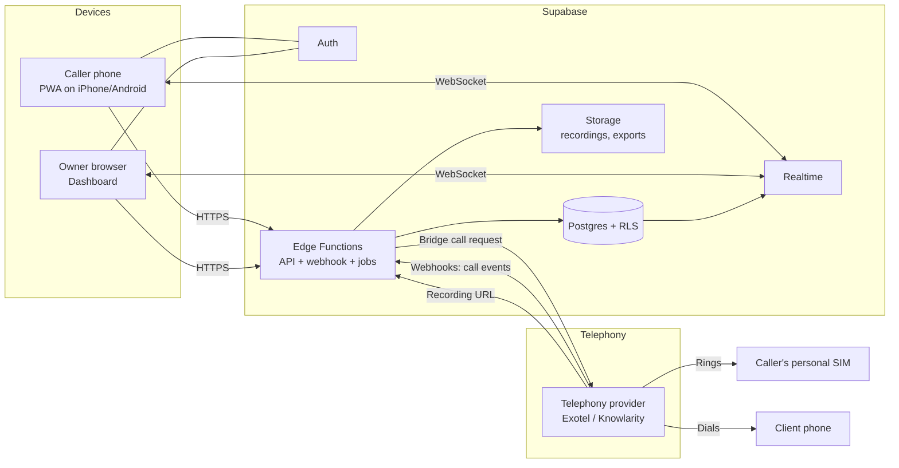
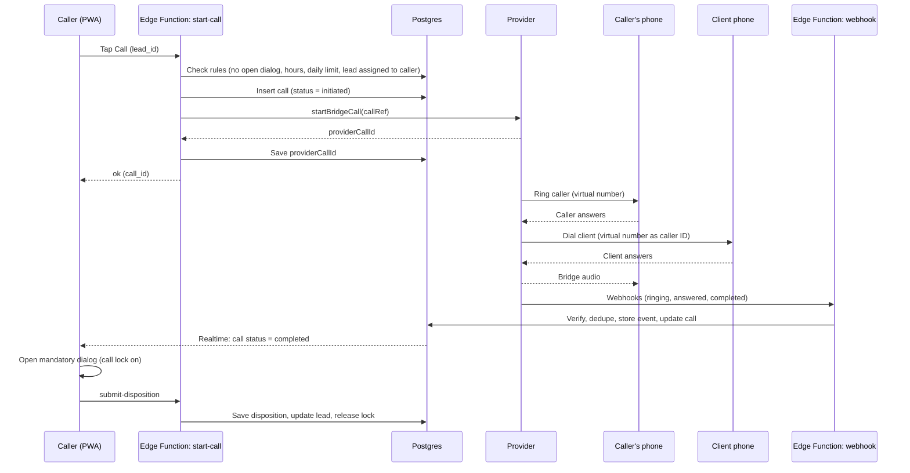
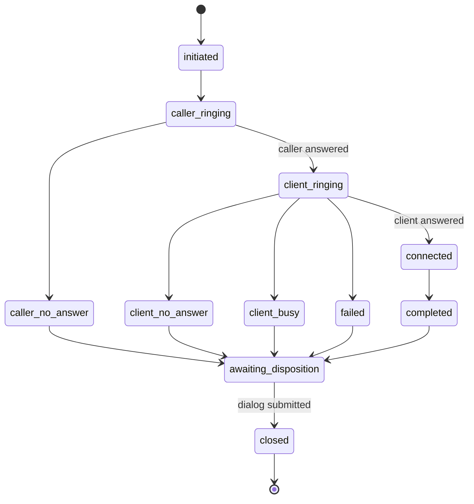

# Cold-Calling Tracker: Product Info & Technical Architecture

**Owner:** Orvyqmedia
**Document status:** Draft v1 for build planning
**Date:** 17 October 2026

---

## 1. Purpose

Orvyqmedia assigns lists of phone numbers to employees for cold calling. The owner needs software that:

1. Assigns numbers to employees and tracks progress.
2. **Proves** each call actually happened, using a record the employee cannot create or edit.
3. Forces the employee to record the outcome right after each call: was the client interested or not, and why.
4. Gives the owner a dashboard with productivity, outcomes, reasons and flagged entries.

## 2. Key decisions (already agreed)

| Topic | Decision |
|---|---|
| Solution type | Custom-built, not a ready-made tool |
| Employee devices | Mostly iPhone, some Android |
| Calling method | Employees use their own phones and personal SIMs |
| Proof of calls | Cloud telephony bridge calling (Option A): provider rings the employee's SIM, then dials the client and joins both |
| Client sees | The company's virtual number, not the employee's personal number |
| Post-call step | Mandatory interested / not interested dialog with reasons |
| Employee app | Web app (PWA) installed to the phone's home screen |
| Backend | Supabase (Postgres, Auth, Realtime, Edge Functions) |
| Telephony provider | Exotel preferred; Knowlarity as alternative; accessed through an adapter so it can be swapped |

**Why bridge calling:** iOS does not let apps read the call history, and a direct call from a personal SIM never passes through any system the owner controls. Routing the call through a provider creates an independent record (status, times, duration, optional recording).

## 3. Users and roles

| Role | Who | Can do |
|---|---|---|
| **Owner / Admin** | Business owner | Everything: import numbers, assign, view all data, manage employees, configure reasons, export, review flags |
| **Manager** (optional, phase 2) | Team lead | View and reassign within their team |
| **Caller** | Employee | See own assigned numbers, place calls, fill post-call dialog, view own stats |

## 4. Scope

### 4.1 In scope (v1)
- Login and role-based access.
- Import numbers (CSV or paste) and assign to callers.
- Place calls through the provider (bridge calling).
- Webhook ingestion of call records and live status in the app.
- Mandatory post-call dialog with reasons.
- Follow-up scheduling for interested leads.
- Owner dashboard, call log, flags, CSV export.
- Optional call recording (off by default).

### 4.2 Out of scope (v1)
- Native iOS/Android apps.
- Reading the phone's own call log (not possible on iOS).
- Automatic dialers (power/predictive dialing), IVR, SMS, WhatsApp.
- CRM sync (planned for phase 3).

## 5. Functional requirements

### 5.1 Authentication
- **FR-1** Callers log in with phone-number OTP or email magic link; the owner uses email plus OTP.
- **FR-2** Each caller profile stores the **E.164 mobile number** that the provider will ring. The number is verified by OTP at onboarding.
- **FR-3** The owner can deactivate a caller instantly; deactivated users lose access and their assigned numbers return to the pool.

### 5.2 Lead management
- **FR-4** Import via CSV or paste: phone, optional name, company, notes, source.
- **FR-5** Numbers are normalised to E.164 and validated. Duplicates within the system are rejected or merged (owner's choice at import).
- **FR-6** Optional DND check flag per lead (status field filled by an external check or manually).
- **FR-7** Assign leads to callers individually, in bulk, or by even split. Reassign pending leads at any time.
- **FR-8** Lead statuses: `new`, `assigned`, `in_progress`, `called`, `interested`, `not_interested`, `follow_up`, `unreachable`, `do_not_call`.

### 5.3 Calling
- **FR-9** The caller taps **Call** on a lead. The backend requests a bridge call from the provider.
- **FR-10** The app shows live call state (see section 8) and tells the caller to answer the incoming call from the virtual number.
- **FR-11** Only one active call per caller at a time.
- **FR-12** A call can be attempted at most N times per lead per day (configurable), and only within configured calling hours.

### 5.4 Post-call dialog
- **FR-13** When a call reaches a terminal state, a **full-screen dialog** opens and cannot be dismissed without completing it.
- **FR-14** The next lead stays locked until the dialog is submitted (**call lock**).
- **FR-15** If the call did not connect, the dialog offers only the not-connected reasons (no answer, busy, switched off, wrong number, voicemail, disconnected).
- **FR-16** If connected, the caller chooses **Interested** or **Not interested**, then at least one reason, plus an optional note (see section 10).
- **FR-17** Interested leads can have a follow-up date/time and channel (call back, send proposal, demo, meeting).
- **FR-18** Dialog submissions are immutable once saved. The owner can add a correction note, which is stored as a separate audit entry.

### 5.5 Owner dashboard
- **FR-19** Per-caller metrics (section 11), filterable by date, caller and batch.
- **FR-20** Call log with status, duration, outcome, reasons, notes and recording link.
- **FR-21** Flag queue for suspicious entries (section 12) with review, dismiss and comment actions.
- **FR-22** Reasons report: top reasons for interest and rejection, by caller and over time.
- **FR-23** Follow-ups due list.
- **FR-24** CSV export of leads, calls and dispositions.

## 6. System architecture

### 6.1 High-level view



### 6.2 Components

| Component | Technology | Responsibility |
|---|---|---|
| **Caller PWA** | Next.js or Vite + React, Tailwind, service worker | Lead queue, Call button, live call state, post-call dialog, personal stats |
| **Owner dashboard** | Same codebase, role-gated routes | Import, assign, monitor, flags, reports |
| **API layer** | Supabase Edge Functions (Deno/TypeScript) | Start call, import leads, submit disposition, admin actions |
| **Webhook receiver** | Edge Function (public, secret-verified) | Receives provider events, validates, stores raw payload, updates call state |
| **Reconciliation job** | Scheduled Edge Function (cron) | Polls provider for calls missing a final webhook; closes stuck calls |
| **Telephony adapter** | TypeScript module with one interface | Isolates provider-specific API shapes so Exotel can be replaced |
| **Database** | Supabase Postgres with Row Level Security | System of record |
| **Realtime** | Supabase Realtime | Pushes call state changes to the app so the dialog opens instantly |
| **Storage** | Supabase Storage (private bucket) | Recordings (if enabled), CSV exports |
| **Notifications** | Web push (iOS home-screen PWAs on recent iOS versions), in-app banners | Follow-up reminders, "complete your last call" nudges |
| **Monitoring** | Edge Function logs, Sentry, uptime check | Errors, webhook failures, latency |

### 6.3 Telephony adapter interface

All provider calls go through one interface so the rest of the system never sees provider-specific fields:

```ts
interface TelephonyProvider {
  startBridgeCall(input: {
    callerNumber: string;      // E.164, employee's personal SIM
    clientNumber: string;      // E.164
    virtualNumber: string;     // caller ID shown to client
    callRef: string;           // our call UUID, echoed back in webhooks
    record: boolean;
    statusCallbackUrl: string;
  }): Promise<{ providerCallId: string }>;

  getCall(providerCallId: string): Promise<NormalizedCall>;   // for reconciliation
  parseWebhook(req: Request): Promise<NormalizedCallEvent>;   // verifies and normalises
  hangup?(providerCallId: string): Promise<void>;
}
```

A `FakeProvider` implementation simulates calls so the whole flow can be built and tested before opening a real provider account.

## 7. Call flow



### 7.1 Call state machine



`awaiting_disposition` is the **call lock** state. A caller with any call in this state cannot start a new call.

### 7.2 Reliability rules
- **Idempotency:** each webhook is stored with the provider's event ID; duplicates are ignored.
- **Out-of-order events:** state only moves forward; late "ringing" events never overwrite "completed".
- **Missing webhook:** the reconciliation job runs every few minutes, finds calls older than a threshold without a terminal state, and fetches the final record from the provider API.
- **Caller never answers:** provider reports `caller_no_answer`; the lead stays unchanged but the attempt counts.
- **App closed mid-call:** the dialog is restored on next open from the DB (state lives server-side, not in the browser).
- **Provider outage:** the Call button shows a clear error; no fake "called" record is ever created.

## 8. Data model

All timestamps are `timestamptz` in UTC. All tables have `id uuid primary key`, `created_at`, and `updated_at` unless noted.

### 8.1 Tables

**`profiles`**
| Column | Type | Notes |
|---|---|---|
| id | uuid | = auth user id |
| full_name | text | |
| role | enum | `owner`, `manager`, `caller` |
| mobile_e164 | text | Number the provider rings; unique |
| mobile_verified_at | timestamptz | |
| is_active | boolean | |
| team_id | uuid null | phase 2 |

**`lead_batches`**
| Column | Type | Notes |
|---|---|---|
| name | text | e.g. "Oct fashion brands" |
| source | text | |
| created_by | uuid | |
| notes | text | |

**`leads`**
| Column | Type | Notes |
|---|---|---|
| batch_id | uuid | |
| phone_e164 | text | unique per owner account |
| name, company, notes | text | |
| assigned_to | uuid null | profile id |
| status | enum | see FR-8 |
| dnd_status | enum | `unknown`, `clear`, `registered` |
| attempt_count | int | |
| last_call_at | timestamptz | |
| next_follow_up_at | timestamptz null | |

**`calls`**
| Column | Type | Notes |
|---|---|---|
| lead_id, caller_id | uuid | |
| provider | text | `exotel`, `fake`, etc. |
| provider_call_id | text | unique |
| virtual_number | text | caller ID used |
| status | enum | state machine in 7.1 |
| initiated_at, caller_answered_at, client_answered_at, ended_at | timestamptz | |
| caller_leg_secs, client_leg_secs, talk_secs | int | `talk_secs` = bridged conversation time |
| end_reason | text | normalised |
| recording_path | text null | Storage path |
| cost_estimate | numeric null | filled from provider details |

**`call_events`** (raw, append-only)
| Column | Type | Notes |
|---|---|---|
| call_id | uuid null | |
| provider_event_id | text | unique, for dedupe |
| payload | jsonb | untouched provider payload |
| received_at | timestamptz | |
| signature_valid | boolean | |

**`dispositions`** (one per closed call, immutable)
| Column | Type | Notes |
|---|---|---|
| call_id | uuid | unique |
| caller_id | uuid | |
| connected | boolean | caller's claim, compared against provider data |
| outcome | enum | `interested`, `not_interested`, `not_connected` |
| reason_ids | uuid[] | from `reasons` |
| other_reason_text | text null | only when "Other" chosen |
| note | text | |
| submitted_at | timestamptz | |
| seconds_after_call_end | int | time taken to fill the dialog |

**`reasons`** (owner-configurable)
| Column | Type | Notes |
|---|---|---|
| outcome | enum | which outcome the reason belongs to |
| label | text | |
| sort_order | int | |
| is_active | boolean | |

**`follow_ups`**
| Column | Type | Notes |
|---|---|---|
| lead_id, assigned_to | uuid | |
| due_at | timestamptz | |
| type | enum | `callback`, `proposal`, `demo`, `meeting` |
| status | enum | `open`, `done`, `cancelled` |
| source_disposition_id | uuid | |

**`flags`**
| Column | Type | Notes |
|---|---|---|
| call_id | uuid null | |
| caller_id | uuid | |
| rule_code | text | see section 12 |
| severity | enum | `info`, `warn`, `high` |
| details | jsonb | |
| status | enum | `open`, `dismissed`, `confirmed` |
| reviewed_by | uuid null | |
| review_note | text | |

**`audit_log`** (append-only): actor, action, entity, entity_id, before/after jsonb, ip, timestamp.

**`settings`**: calling hours, daily attempt limit, recording on/off, min talk seconds for "connected", flag thresholds, virtual number list.

### 8.2 Key indexes and constraints
- `calls(provider_call_id)` unique; `call_events(provider_event_id)` unique.
- Partial unique index: at most one call per caller in an active or `awaiting_disposition` state.
- `leads(assigned_to, status)`, `calls(caller_id, initiated_at desc)`, `dispositions(submitted_at)`.
- `dispositions.call_id` unique; no update or delete allowed through RLS.

## 9. API surface

All endpoints are Edge Functions behind Supabase Auth JWT, except the webhook.

| Endpoint | Method | Role | Purpose |
|---|---|---|---|
| `/leads/import` | POST | owner | Upload CSV/paste, normalise, dedupe |
| `/leads/assign` | POST | owner | Bulk assign or reassign |
| `/me/queue` | GET | caller | Assigned pending leads |
| `/calls/start` | POST | caller | Validate rules, create call, request bridge |
| `/calls/:id` | GET | caller/owner | Call status |
| `/calls/:id/disposition` | POST | caller | Submit post-call dialog |
| `/follow-ups` | GET/PATCH | caller/owner | List and complete follow-ups |
| `/admin/dashboard` | GET | owner | Aggregated metrics |
| `/admin/flags` | GET/PATCH | owner | Review flags |
| `/admin/export` | POST | owner | CSV export job |
| `/admin/users` | POST/PATCH | owner | Create, deactivate callers |
| `/webhooks/telephony` | POST | provider | Call events (secret-verified) |

### 9.1 `/calls/start` validation order
1. Caller is active and verified.
2. Lead is assigned to this caller and not `do_not_call`.
3. No call in `awaiting_disposition` or active state for this caller.
4. Within calling hours and under the daily attempt limit.
5. DND rule satisfied (if enforced).
6. Create `calls` row, then call the provider. If the provider call fails, mark the row `failed` with the error and return a readable message.

### 9.2 `/calls/:id/disposition` validation
- Call belongs to the caller and is in `awaiting_disposition`.
- `outcome` is consistent with the provider record (see rules below).
- At least one reason selected; "Other" requires text.
- If outcome is interested, a follow-up can be added.
- On success: save disposition, update lead status and counters, create follow-up, set call `closed`, release the call lock, and run flag rules.

## 10. Post-call dialog specification

### 10.1 Screen logic
1. Header: client number/name, call duration, call result as reported by the provider (read-only).
2. Question 1 (shown only if the provider says the call connected): **Was the client interested?** `Interested` / `Not interested`.
3. Question 2: **Reasons** (multi-select chips, at least one).
4. Optional note, 500 characters.
5. If interested: follow-up date/time and type.
6. Submit. The button stays disabled until required fields are filled.

If the provider reports the call did **not** connect, the caller can only choose a not-connected reason. They cannot claim "interested" on a call the provider says never connected.

### 10.2 Default reason lists (editable by the owner)

**Interested**
- Wants pricing / proposal
- Wants a demo or meeting
- Needs to discuss with team or partner
- Currently looking for influencer marketing
- Asked for a callback at a specific time
- Referred to another decision maker

**Not interested**
- Budget constraints
- Already has an agency or in-house team
- No need right now
- Bad timing, try later
- Not the decision maker, no referral
- Unhappy with influencer marketing
- Asked not to be contacted again (sets lead to `do_not_call`)

**Not connected**
- No answer
- Busy
- Switched off or unreachable
- Wrong or invalid number
- Voicemail
- Call dropped

### 10.3 Why the dialog is trustworthy
The caller's answers are always stored beside the provider's own record (connected or not, talk seconds), so the owner sees both and the system can flag mismatches.

## 11. Dashboard and reports

### 11.1 Owner overview (per caller and team, date-filterable)
- Calls attempted, connected, connect rate.
- Total and average talk time.
- Interested, not interested, interest rate (of connected calls).
- Pending assigned numbers and completion percentage.
- Average time to fill the dialog after a call.
- Open flags.

### 11.2 Reports
- **Reasons breakdown:** top interest and rejection reasons, by caller, batch and week.
- **Batch performance:** conversion by lead source.
- **Follow-ups:** due today, overdue, completed.
- **Call log:** every call with provider status, duration, outcome, reasons, notes, flags, recording link.
- **Attempts per lead:** how many tries before connecting.

### 11.3 Caller view
A simple page showing today's calls, connect rate, interested count and pending queue, so callers can see their own progress.

## 12. Verification and flag rules

Rules run after each disposition and nightly. Thresholds are in `settings`.

| Code | Rule | Severity |
|---|---|---|
| `NO_PROVIDER_RECORD` | Disposition exists but the provider has no matching call (should be impossible; indicates tampering or bug) | high |
| `CLAIM_MISMATCH` | Caller says connected but provider says not connected | high |
| `SHORT_INTERESTED` | Marked interested or not interested with talk time below the minimum (e.g. under 10 s) | warn |
| `LONG_NOTE_SHORT_CALL` | Long detailed note on a very short call | warn |
| `CALLER_LEG_ONLY` | Caller answered but the client leg never connected, repeated many times | info |
| `SLOW_DIALOG` | Dialog completed much later than the call end | info |
| `OUT_OF_HOURS` | Call outside configured hours | warn |
| `REPEAT_ATTEMPTS` | Same number called more than allowed | warn |
| `LOW_ACTIVITY` | Caller's calls per day far below team median | info |
| `IDENTICAL_PATTERN` | Same reasons and notes pasted repeatedly across calls | warn |

Flags never block work automatically; they go into a review queue for the owner.

## 13. Security

### 13.1 Access control
- Row Level Security on every table. Callers read only their own leads, calls, dispositions and follow-ups; owners read everything.
- Callers cannot update or delete `calls`, `call_events`, `dispositions` or `audit_log`. Only Edge Functions using the service role write them.
- Client numbers are never exposed in bulk to callers: they see only leads currently assigned to them.
- Optional: mask part of the number in the UI and place calls by `lead_id` so callers cannot copy the whole list.

### 13.2 Webhook security
- Secret token or signature verification as supported by the provider, plus HTTPS only and an optional IP allowlist.
- Reject unsigned or stale requests; store invalid attempts in `call_events` with `signature_valid = false`.
- Respond quickly (acknowledge, then process) to avoid provider retries.

### 13.3 Secrets
- Provider API keys and secrets only in Supabase secrets, never in the frontend or repository.
- Separate keys for development and production.

### 13.4 Data protection
- Encryption in transit (TLS) and at rest (Supabase default).
- Private storage bucket for recordings with short-lived signed URLs.
- Rate limiting on login, call start and export endpoints.
- Backups: daily database backups with point-in-time recovery on the paid Supabase tier.
- Audit log for imports, exports, assignments, user changes and flag reviews.

## 14. Legal and compliance (to confirm with a lawyer and the provider)

- **Telemarketing rules (TRAI):** outbound sales calls fall under telemarketing regulations, including registration and DND checks. Ask the provider what they require and add a DND check step before calling.
- **Call recording:** if recording is on, play or state a recording notice to the client, and tell employees. Keep it off until this is settled.
- **Employee data:** callers' personal mobile numbers are stored. Get written consent, state the purpose (routing calls and verifying work), and limit access to the owner.
- **Data protection law (DPDP Act):** treat client numbers as personal data; define retention (for example delete leads and recordings after a set period) and a process for deletion requests.
- **No personal call-log access:** the design deliberately never reads anything from employees' phones.

## 15. Non-functional requirements

| Area | Target |
|---|---|
| Availability | 99.5% or better (provider-dependent) |
| Call start latency | Under 3 s from tap to provider request accepted |
| Dialog appearance | Within 2 s of the terminal webhook |
| Scale (v1) | Up to ~50 callers, ~10,000 leads, ~2,000 calls/day |
| Browser support | Safari iOS (recent versions), Chrome Android, desktop Chrome/Edge/Safari |
| Accessibility | Large touch targets, readable on small screens, works on slow mobile data |
| Data retention | Configurable; default 24 months for call metadata, 90 days for recordings |

## 16. Deployment and environments

| Environment | Purpose | Telephony |
|---|---|---|
| Local / dev | Development | `FakeProvider` |
| Staging | Testing with 1-2 real employees | Provider trial account |
| Production | Live | Provider paid account |

- **Hosting:** frontend on Vercel or Netlify; backend on Supabase. (Your existing Cloudflare/self-hosted setup can also serve the frontend.)
- **CI/CD:** GitHub or GitLab pipeline: lint, type-check, tests, then deploy. Database changes through versioned migrations.
- **Config:** environment variables for provider credentials, webhook secret, base URLs.
- **Domains:** for example `calls.orvyqmedia.online` for the app and a separate path for webhooks.

## 17. Testing strategy

- **Unit tests:** state machine transitions, validation rules, flag rules, phone normalisation.
- **Integration tests:** `FakeProvider` scripts for every call outcome (answered, no answer, busy, caller no-answer, failed, duplicate webhook, out-of-order webhook, missing webhook).
- **RLS tests:** a caller can never read another caller's data or modify protected tables.
- **End-to-end:** start call, simulated webhook, dialog appears, submission unlocks next call.
- **Pilot:** two employees on the real provider for a week before rollout; compare provider records with their own reports.

## 18. Cost model

Monthly cost is roughly:

```
telephony  = calls × average minutes × 2 legs × per-minute rate  (billed in 60-second pulses)
numbers    = virtual number rental
platform   = Supabase plan + hosting (small for this scale)
optional   = storage for recordings, Sentry, SMS/OTP charges
```

Per-minute rates are not published; get quotes from Exotel and Knowlarity. Every call bills two legs (the caller's SIM and the client's phone), so real usage is about double the talk time.

## 19. Risks and limitations

| Risk | Impact | Mitigation |
|---|---|---|
| Client sees company number, not the employee's | Some clients may not pick up unknown numbers | Use a recognisable virtual number; test connect rates in pilot |
| Employee answers, then does not really talk | Fake effort | Talk-time thresholds, recordings (if lawful), flags |
| Employees call leads outside the app | Untracked work | Daily activity benchmarks; app-only access to numbers |
| Provider outage or webhook failure | Missing records | Reconciliation job, status page monitoring, backup provider via adapter |
| Per-minute costs higher than expected | Budget overrun | Daily attempt limits, cost dashboard, pilot first |
| Regulatory issues (DND, recording) | Penalties | Compliance review before launch |
| Caller's phone has poor network | Dropped legs | Show leg status; allow retry |

## 20. Delivery plan

| Phase | Scope | Output |
|---|---|---|
| **0. Setup** | Supabase project, repo, schema, RLS, auth, `FakeProvider` | Working skeleton |
| **1. Core flow** | Lead import/assign, caller queue, start call, state machine, webhook handler, post-call dialog, call lock | End-to-end demo on fake provider |
| **2. Owner dashboard** | Metrics, call log, reasons report, flags, exports | Owner can monitor |
| **3. Real provider** | Adapter for Exotel, webhooks, reconciliation job, number setup | Live test |
| **4. Pilot** | 2 employees, 1 week, tune thresholds and reasons | Pilot report |
| **5. Rollout** | Whole team, training, monitoring | Production |
| **Later** | Recordings, manager role, DND automation, follow-up reminders via push, CRM sync, Android native option | Backlog |

## 21. Open questions

1. Final provider choice and quoted per-minute rate.
2. Does the client seeing a company number instead of the employee's number work for your business?
3. Should call recording be enabled, and what notice will clients hear?
4. How many callers, and roughly how many calls per day each?
5. Calling hours and daily attempt limits per lead?
6. Should callers see the full phone number, or only a masked version?
7. How long to retain call data and recordings?
8. Should callbacks to the virtual number ring the original caller, the owner, or go to voicemail?

---

*End of document.*
