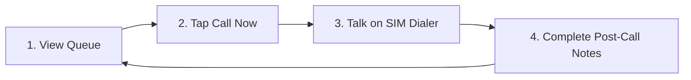

# Orvyqmedia Caller Onboarding & Setup Guide

Welcome to the Orvyqmedia calling team! This guide explains how to install the caller app on your Android phone, set up your device, and understand your calling workflow.

---

## 1. What You Need
- An Android phone (Android 8.0 or newer).
- An active personal SIM with outgoing calling enabled.
- Your login credentials provided by your manager.

---

## 2. Privacy Guarantee (What We Read & What We Don't)

We respect your personal privacy. Our app operates under strict on-device filtering rules (§6):

| What is Verified | What is NEVER Accessed |
|---|---|
| ✅ Outgoing work calls to **assigned leads only** | ❌ **Personal calls** (family, friends, personal contacts) |
| ✅ Call duration (to verify talk time ≥ 10s) | ❌ **Text messages / SMS / WhatsApp** |
| ✅ Timestamp of the work call | ❌ **Contacts list** |
| ✅ Connected / not-connected outcome | ❌ **Audio recordings** (calls are NOT recorded) |

*All filtering happens directly on your device. Personal phone numbers never leave your phone.*

---

## 3. Installation Steps

1. **Download the APK:**
   - Tap the private download link provided by your manager to download `app-release.apk`.
2. **Allow Installation:**
   - When prompted with *"For security, your phone is not allowed to install unknown apps from this source"*, tap **Settings** $\rightarrow$ enable **Allow from this source**.
3. **Open App:**
   - Launch **Orvyqmedia Caller** from your home screen.
4. **Sign In:**
   - Enter your work email and temporary password.
5. **Review Privacy Notice:**
   - Read the 3 safeguards and tap **Accept & Enter Queue**.

---

## 4. Brand-Specific Phone Settings (Crucial)

Certain Android phones aggressively kill background apps. Follow the steps below for your phone brand so your call proofs sync reliably:

### 📱 Xiaomi / Redmi / Poco (MIUI & HyperOS)
1. Open the pre-installed **Security** app $\rightarrow$ **Manage apps** $\rightarrow$ **Orvyqmedia Caller**.
2. Turn ON **Autostart**.
3. Under **Battery saver**, select **No restrictions**.
4. In App permissions, ensure **Phone** and **Call logs** are allowed.

### 📱 Samsung (One UI)
1. Go to **Settings** $\rightarrow$ **Battery and device care** $\rightarrow$ **Battery**.
2. Tap **Background usage limits** $\rightarrow$ **Never sleeping apps**.
3. Tap **+** and add **Orvyqmedia Caller**.

### 📱 Realme / Oppo (ColorOS)
1. Long-press the **Orvyqmedia Caller** app icon $\rightarrow$ tap **App info**.
2. Tap **Battery usage** $\rightarrow$ turn on **Allow background activity** and **Allow auto-launch**.

### 📱 OnePlus (OxygenOS)
1. Go to **Settings** $\rightarrow$ **Battery** $\rightarrow$ **Battery optimization**.
2. Find **Orvyqmedia Caller** $\rightarrow$ choose **Don't optimize**.

### 📱 Vivo / iQOO (Funtouch OS)
1. Go to **Settings** $\rightarrow$ **Battery** $\rightarrow$ **Background power consumption management**.
2. Find **Orvyqmedia Caller** $\rightarrow$ choose **High background power consumption**.

---

## 5. Daily Calling Workflow

### 1. View Your Queue
- Open the app to see your assigned leads.
- Use the filter tabs (*All, Pending, Follow-ups, Completed*) or search bar.

### 2. Tap "Call Now"
- Tapping **Call Now** opens your phone's native dialer with the client's number prefilled.
- Tap the green call button on your SIM dialer to place the call.

### 3. Talk with the Client
- **The 10-Second Rule:** To qualify as a connected conversation, calls must last at least **10 seconds**.
- Short rings or voicemail under 10 seconds will automatically count as not connected.

### 4. Mandatory Post-Call Notes (Call Lock)
- As soon as your call ends, return to the Orvyqmedia app.
- The app automatically reads your SIM call log and fills in your verified duration (e.g. 45s).
- Choose the call outcome:
  - **Interested:** Select follow-up date and channel (*Call, WhatsApp, Email, Meeting*).
  - **Not Interested:** Select the primary reason (*e.g. "Price too high", "Using competitor"*).
  - **Not Connected:** (*e.g. "No Answer / Ringing", "Busy", "Switched Off"*).
- Tap **Submit Disposition & Unlock Queue**.
- **Important:** You cannot make another call until your previous call notes are submitted.
