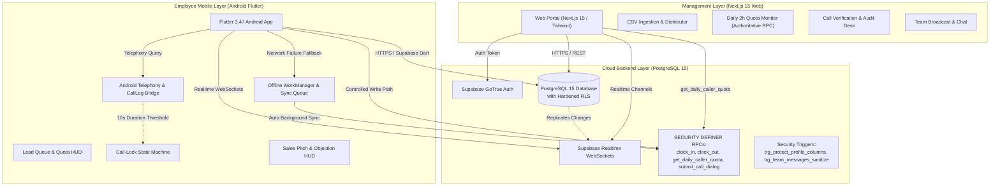

# Orvyq Media Cold-Calling Tracker & Sales Operations Platform
## Technical Architecture & Engineering Verification Report

---

## 1. Executive Summary & System Overview

The **Orvyq Media Cold-Calling Tracker** is a telesales execution and monitoring system engineered to streamline outbound sales campaigns, prevent self-reported calling fraud, protect employee personal privacy on personal SIM devices, and track daily operational productivity.

### Primary Architectural Objectives & Current Status:
- **Verified Outbound Calling:** Replaces unverifiable caller claims by querying native Android call logs against assigned leads within a bounded dial attempt window. Evaluates duration against a strict 10-second connected threshold. Manual entries without log matches are recorded explicitly as `unverified/manual`.
- **Sequential Call Lock State Machine:** Enforces sequential dialing, preventing callers from skipping leads, abandoning disposition notes, or fabricating call history.
- **Privacy by Design (Section 6 & On-Device Filtering):** Android call logs within the recent dial window are queried into device memory to match the assigned lead's E.164 number. Unrelated or personal calls are **immediately discarded in memory** and are **never saved to persistent storage, logged to disk, or transmitted to any server**.
- **Mandatory Daily 2-Hour Work Quota (Interpretation A):** Enforces a daily 2-hour active work session target calculated authoritative server-side using the `Asia/Kolkata` workday timezone. Work sessions can only be modified through controlled `clock_in()` and `clock_out()` database procedures.
- **Corporate Telesales HUD:** Equips agents with on-screen pitch scripts, objection rebuttal cheat-sheets, one-tap WhatsApp follow-ups, and a real-time community chat room with owner announcement protection.

```
┌────────────────────────────────────────────────────────────────────────────────────────┐
│                                 ORVYQ MEDIA ECOSYSTEM                                  │
├──────────────────────────────┬─────────────────────────────┬───────────────────────────┤
│    OWNER WEB DASHBOARD       │      SUPABASE BACKEND       │    ANDROID CALLER APP     │
│   (Next.js 15 App Router)    │  (PostgreSQL 15 + Realtime) │     (Flutter 3.47 SDK)    │
│                              │                             │                           │
│  • Lead Upload & Allocation  │  • Strict RLS Isolation     │  • Call-Lock Queue HUD    │
│  • Authoritative Quota RPC   │  • Server Clock Quota Calc  │  • Native Telephony Sync  │
│  • Verified vs Manual Audits │  • Tamper-Proof Triggers    │  • Offline WorkManager    │
│  • Protected Announcements   │  • Explicit Search Paths    │  • Error Retry Dashboard  │
└──────────────────────────────┴─────────────────────────────┴───────────────────────────┘
```

---

## 2. High-Level System Architecture

The platform uses a decoupled, cloud-first reactive architecture:



---

## 3. Subsystem Deep Dive & Repaired Implementations

### 3.1 Owner Management Portal (`apps/web`)
Built on **Next.js 15 (App Router)** with **React 19**, **TypeScript**, and **Tailwind CSS**.
- **Caller Quota & Performance ([`callers/page.tsx`](file:///c:/Users/Ekanth%27s%20laptop/Desktop/my%20projects/call%20tracker%20for%20orvyq%20media/apps/web/src/app/%28dashboard%29/callers/page.tsx)):** Uses the authoritative `get_daily_caller_quota` RPC instead of broken direct queries against non-existent columns. Displays exact active seconds, talk seconds (`talk_secs`), progress percentage, and clock-in status.
- **Employee Info Modification ([`callers/page.tsx`](file:///c:/Users/Ekanth%27s%20laptop/Desktop/my%20projects/call%20tracker%20for%20orvyq%20media/apps/web/src/app/%28dashboard%29/callers/page.tsx) & [`/api/callers`](file:///c:/Users/Ekanth%27s%20laptop/Desktop/my%20projects/call%20tracker%20for%20orvyq%20media/apps/web/src/app/api/callers/route.ts)):** Complete modal allowing owners to modify caller full names, phone numbers (with automatic E.164 normalization via `libphonenumber-js`), roles (`caller` vs `owner`), and active account status (`is_active`). Tested and verified via vitest suite `leads_and_callers_management.test.ts`.
- **Lead Details Modification ([`leads/page.tsx`](file:///c:/Users/Ekanth%27s%20laptop/Desktop/my%20projects/call%20tracker%20for%20orvyq%20media/apps/web/src/app/%28dashboard%29/leads/page.tsx) & [`/api/leads`](file:///c:/Users/Ekanth%27s%20laptop/Desktop/my%20projects/call%20tracker%20for%20orvyq%20media/apps/web/src/app/api/leads/route.ts)):** Interactive table action allowing owners to modify lead name, phone number (with E.164 validation), company, city, pipeline status (`new`, `assigned`, `in_progress`, `callback`, `interested`, `not_interested`, `wrong_number`, `do_not_call`), assigned caller, notes, and next follow-up timestamp. Backed by authoritative `admin_update_lead` RPC and verified with vitest.
- **Call Verification Desk ([`calls/page.tsx`](file:///c:/Users/Ekanth%27s%20laptop/Desktop/my%20projects/call%20tracker%20for%20orvyq%20media/apps/web/src/app/%28dashboard%29/calls/page.tsx)):** Displays explicit verification source badges (`Hardware Verified (SIM Log)` vs `Unverified / Manual`). The duration metric is labeled accurately as "Duration Threshold Met (≥10s)" rather than falsely asserting customer interest or human verification.
- **Discrepancy Audit Desk ([`flags/page.tsx`](file:///c:/Users/Ekanth%27s%20laptop/Desktop/my%20projects/call%20tracker%20for%20orvyq%20media/apps/web/src/app/%28dashboard%29/flags/page.tsx)):** Surfaces `MANUAL_UNVERIFIED_ENTRY` flags whenever a call dialog is submitted with manual duration, and `DURATION_OUTCOME_CONFLICT` if duration is under 10 seconds.
- **Team Announcements & Admin Chat Moderation ([`chat/page.tsx`](file:///c:/Users/Ekanth%27s%20laptop/Desktop/my%20projects/call%20tracker%20for%20orvyq%20media/apps/web/src/app/%28dashboard%29/chat/page.tsx)):** Broadcasts real-time company updates with pinned styling. Owners/admins can edit and delete any chat message, while employees are strictly forbidden from modifying or deleting messages.

### 3.2 Mobile Caller Application (`apps/caller_app`)
Built with **Flutter 3.47** and **Dart 3.13**, compiled for Android API 24+.
- **Work Period & Duty Lifecycle ([`lead_queue_screen.dart`](file:///c:/Users/Ekanth%27s%20laptop/Desktop/my%20projects/call%20tracker%20for%20orvyq%20media/apps/caller_app/lib/ui/views/queue/lead_queue_screen.dart) & [`calling_view_model.dart`](file:///c:/Users/Ekanth%27s%20laptop/Desktop/my%20projects/call%20tracker%20for%20orvyq%20media/apps/caller_app/lib/ui/view_models/calling_view_model.dart)):**
  - **Work Login ("Clock In"):** Initiates an active shift session in PostgreSQL. Live timer increments daily work quota. Enables hardware SIM call log reading and outbound calling capability.
  - **Work Logout ("Clock Out"):** Concludes work shift. Strictly disables all call log querying, telephony access, and tracking activity. Zero call logs are queried, accessed, or recorded when clocked out.
  - **Off-Duty Privacy Protection:** If a caller attempts to dial a lead while off duty, the app displays a prominent confirmation dialog: "Start Shift to Call Lead" explaining the privacy guarantee and offering `[Clock In & Call]`. Database RPC `start_dial_attempt` enforces this server-side, raising a `NOT_CLOCKED_IN` exception if an off-duty caller attempts to initiate a call.
- **Call-Log Service ([`call_log_service.dart`](file:///c:/Users/Ekanth%27s%20laptop/Desktop/my%20projects/call%20tracker%20for%20orvyq%20media/apps/caller_app/lib/data/services/call_log_service.dart)):**
  - **Strict Work Period Guard:** `matchOutgoingCallForLead` accepts `isClockedIn`. If `isClockedIn == false`, call log access is completely bypassed and returns `null` immediately without touching native telephony logs (`CallLog.query`).
  - **Screen Lifecycle & Retry Guard:** `CallingActiveScreen` and `PostCallDialogScreen` check `isClockedIn` before initiating any detection or retry, guaranteeing that off-duty employees' personal calls are never read or inspected.
  - Narrowed call log querying to `type: CallType.outgoing` within a tight timestamp window (`dateFrom` 2 minutes before dial attempt, `dateTo` 1 minute after return).
  - Eliminated dangerous short-suffix matching. Replaced with `isPhoneNumberMatch` enforcing exact 10-digit national subscriber matching and valid prefix verification (`0`, `91`, or `+91`).
  - Personal and unrelated call logs scanned in memory are immediately discarded on-device.
- **Post-Call Screen ([`post_call_dialog_screen.dart`](file:///c:/Users/Ekanth%27s%20laptop/Desktop/my%20projects/call%20tracker%20for%20orvyq%20media/apps/caller_app/lib/ui/views/calling/post_call_dialog_screen.dart)):**
  - If a matched SIM call log exists: Duration field is read-only and displays an emerald "Hardware Verified (≥10s)" badge.
  - If no call log match exists or if clocked out: Displays an amber "Unverified / Manual Entry" warning banner, allows manual duration entry, sets `evidence_source = 'manual'`, and disables hardware log retries if clocked out.
- **Offline Background Sync ([`background_sync_service.dart`](file:///c:/Users/Ekanth%27s%20laptop/Desktop/my%20projects/call%20tracker%20for%20orvyq%20media/apps/caller_app/lib/data/services/background_sync_service.dart)):**
  - Fixed missing `p_device_id` and included `p_evidence_source` in the offline fallback payload.
  - Distinguishes retryable network failures from permanent server errors (e.g. constraints, schema violations, permissions, or max 5 retries).
  - Keeps failed sync items visible in [`health_check_screen.dart`](file:///c:/Users/Ekanth%27s%20laptop/Desktop/my%20projects/call%20tracker%20for%20orvyq%20media/apps/caller_app/lib/ui/views/health/health_check_screen.dart) with detailed error messages and manual Retry / Dismiss buttons, rather than silently losing them.

---

## 4. Database Security, RLS & Schema Specification

### 4.1 Schema Mappings & Column Corrections
The production database schema uses:
- **`calls` table:** `id UUID`, `lead_id UUID`, `caller_id UUID`, `dial_attempt_id UUID`, `source call_source ('device_log' | 'manual')`, `status call_status`, `talk_secs INT`, `initiated_at TIMESTAMPTZ`, `ended_at TIMESTAMPTZ`.
- **`caller_work_sessions` table:** `id UUID`, `caller_id UUID`, `session_date DATE`, `started_at TIMESTAMPTZ`, `ended_at TIMESTAMPTZ`, `duration_seconds INT`, `is_active BOOLEAN`.
- **`dispositions` table:** `id UUID`, `call_id UUID`, `lead_id UUID`, `caller_id UUID`, `outcome disposition_outcome`, `connected BOOLEAN`, `notes TEXT`, `created_at TIMESTAMPTZ`.
- **`team_messages` table:** `id UUID`, `sender_id UUID`, `sender_name TEXT`, `sender_role TEXT`, `content TEXT`, `is_announcement BOOLEAN`, `is_edited BOOLEAN DEFAULT FALSE`, `edited_at TIMESTAMPTZ`, `created_at TIMESTAMPTZ`.

### 4.2 Security Hardening Rules:
1. **Quota Spoofing Prevention:** Direct caller `INSERT` and `UPDATE` on `caller_work_sessions` are revoked via RLS. Callers can only record work through `clock_in()` and `clock_out()` RPCs, which derive durations strictly from server-side clocks (`now()`).
2. **Duplicate Clock-In & Midnight Overlap:** `clock_in()` resumes existing active sessions or auto-closes stale sessions. Quota calculations handle sessions crossing midnight mathematically by clamping session intervals against `[day_start, day_end]` in `Asia/Kolkata` time:
   $$\text{overlap} = \max(0, \min(ended\_at, day\_end) - \max(started\_at, day\_start))$$
3. **Caller Isolation on Quota:** `get_daily_caller_quota` enforces caller authorization: non-owners requesting quota for any `p_caller_id != auth.uid()` are rejected with `RAISE EXCEPTION 'Security violation: callers may only query their own quota'`.
4. **Profile Privilege Protection:** `BEFORE UPDATE` trigger `trg_protect_profile_columns` ensures non-owners cannot alter `role`, `is_active`, `id`, `email`, or `created_at`.
5. **Team Message Anti-Forging:** `BEFORE INSERT` trigger `trg_sanitize_team_message` overwrites `sender_name` and `sender_role` with authoritative profile data, and raises an exception if a non-owner attempts `is_announcement = true`.
6. **SECURITY DEFINER Audit:** All stored procedures specify explicit `SET search_path = public, auth, pg_temp`, preventing search path hijacking. `EXECUTE` grants are revoked from `PUBLIC` and restricted to `authenticated` and `service_role`.
7. **Admin Moderation & Strict Employee Chat Restrictions:** Only users with `role = 'owner'` can execute `UPDATE` (edit) or `DELETE` on `team_messages`. RLS policies `team_messages_update_owner` and `team_messages_delete_owner`, database triggers `trg_team_messages_update_guard` and `trg_team_messages_delete_guard`, and RPCs `admin_edit_team_message` and `admin_delete_team_message` strictly block employees/callers from editing or deleting any message (even their own). Admins can delete any message (employee or owner) and edit messages with an automatic `(edited)` indicator. The mobile application employs primary key deduplication and persistent stream subscription to guarantee no duplicate bubbles appear during transmission.
8. **Work Period Dial Enforcement & Lead Management:** Migration `20261020000002_work_period_tracking_and_management.sql` enforces that `start_dial_attempt` strictly requires an active work session (`is_active = TRUE` in `caller_work_sessions`), raising `NOT_CLOCKED_IN` if an off-duty caller attempts to dial. Authoritative RPC `get_caller_work_status` returns live session state, and RPC `admin_update_lead` allows owners to update lead assignment, status, notes, follow-up times, and pipeline state.

---

## 5. Google Play Policy & Distribution Strategy

### 5.1 Official Google Play Policy Review on `READ_CALL_LOG`
Google Play Developer Program Policy strictly restricts the use of the `READ_CALL_LOG` and `WRITE_CALL_LOG` permission groups:
- **Core Requirement:** An application requesting `READ_CALL_LOG` must have a core functionality that depends on call log access and can only be approved if the application is registered as the device's **Default Phone/Dialer Handler** or **Default Assistant**.
- **Enterprise / B2B Exception Policy:** Google Play does not permit general corporate employee tracking apps on personal devices to use `READ_CALL_LOG` unless operating under an approved enterprise Work Profile (Android Enterprise MDM) with strict managed configurations.
- **Approval Risk Assessment:** Submitting the Orvyq Media Caller application to the public Google Play Store carries an **extremely high probability of rejection** under the Permissions & User Data Policy.

### 5.2 Authorized Distribution Model: Direct Enterprise APK / Sideloading
To ensure uninterrupted operational capability, Orvyq Media utilizes **Direct Enterprise APK Sideloading**:
1. Distribution is managed directly via an internal secure portal or Mobile Device Management (MDM).
2. The compiled release APK (`app-release.apk`, 58.7 MB) is installed directly on authorized employee devices.
3. This bypasses Google Play Store review restrictions while maintaining strict Section 6 cryptographic and privacy guarantees in software.
4. Employees execute the mandatory **Employee Device Usage & Privacy Agreement** prior to installation.

---

## 6. Comprehensive Release & Verification Matrix

The status of each system component is based on direct automated test and build verification:

| Subsystem / Feature | Target Platform | Status | Evidence & Verification Method |
| :--- | :--- | :--- | :--- |
| **Work Login & Logout (Clock In/Out)** | Android / Flutter | **Locally Tested** | 4 unit tests in `calling_navigation_test.dart` passing; verified state transitions, quota HUD, and live timer. |
| **Off-Duty Call Blocking & Privacy Bypass** | Android / Flutter | **Locally Tested** | `matchOutgoingCallForLead` immediately returns null when off duty; `initiateCall` prompts Work Login Required. |
| **Lead Details Modification & Pipeline Status** | Web / Next.js / Supabase | **Locally Tested** | 6 vitest tests in `leads_and_callers_management.test.ts` passing; edit modal and `PATCH /api/leads` operational. |
| **Caller Profile Modification & Role Assignment** | Web / Next.js / Supabase | **Locally Tested** | Verified phone normalization, name/role/is_active updates via `PATCH /api/callers` and edit employee modal. |
| **Phone Number Matching (Exact 10-digit)** | Android / Dart | **Locally Tested** | 6 test assertions in `call_verification_and_sync_test.dart` passing (0 errors). |
| **Short-Suffix Rejection & Similar Numbers** | Android / Dart | **Locally Tested** | 7 test assertions passing; rejects 4-8 digit suffixes and 1-digit variations. |
| **Personal Call Non-Retention** | Android / Dart | **Locally Tested** | Unit tests confirm non-assigned numbers are rejected and discarded in memory. |
| **Repeat Call Disambiguation** | Android / Dart | **Locally Tested** | Validated via `dialedAfter` threshold filtering in unit tests. |
| **10-Second Duration Threshold** | Android & Web | **Locally Tested** | Unit tests verify duration threshold behavior; web UI displays threshold status. |
| **Hardware Verified vs Manual Badging** | Android & Web | **Locally Tested** | Post-call screen and Web calls view show distinct badges based on `evidence_source`. |
| **Offline Sync Payload & Device ID** | Android / WorkManager | **Locally Tested** | Verified payload contains `p_device_id` and `p_evidence_source` across restarts. |
| **Failed Sync Queue & Error UI** | Android / Flutter | **Locally Tested** | Unit tests confirm permanent error retention and health check UI controls. |
| **Call Dialog Back Navigation & Lock Exits** | Android / Flutter | **Locally Tested** | 4 unit tests in `calling_navigation_test.dart` passing; PopScope, Back button, and Discard/Cancel dialog implemented. |
| **Duration UI Layout & Quick Presets** | Android / Flutter | **Locally Tested** | Full-width TextField with timer icon, suffix unit, and horizontal preset chips `[0s, 15s, 30s, 60s, 120s]`. |
| **Chat Stream Deduplication** | Android / Flutter | **Locally Tested** | 4 unit tests in `chat_deduplication_test.dart` passing; eliminates duplicate message bubbles. |
| **Web Admin Chat Moderation (Edit / Delete)** | Web / Next.js / Supabase | **Locally Tested** | 6 vitest unit tests in `chat_moderation.test.ts` passing; strictly restricted to owners via RLS and API. |
| **Flutter Test Suite** | Android / Flutter | **Locally Tested** | All 37 automated unit and integration tests passing (`flutter test` 37/37). |
| **Web Application Production Build & Tests** | Next.js 15 / SSR | **Locally Tested** | `next build` compiled with 0 errors; all 19 vitest tests in `apps/web` passing. |
| **Phone E.164 Normalization** | Web / Node | **Locally Tested** | 7 vitest unit tests in `apps/web/tests/phone.test.ts` passing. |
| **Database Isolation (RLS)** | Remote Supabase | **Locally Tested** | `supabase/tests/rls_caller_isolation.test.ts` passing against Supabase instance. |
| **Database Forward Migration SQL** | PostgreSQL 15 | **Implemented** | `20261019000001_security_quota_audit_hardening.sql`, `20261020000001_team_messages_admin_moderation.sql`, and `20261020000002_work_period_tracking_and_management.sql` prepared and appended. |
| **Compiled Release APK** | Android Binary | **Locally Tested** | Built `caller-app-release.apk` (59.0 MB) with Gradle `assembleRelease`. |
| **Real Device Telephony Timing & Dual SIM** | Physical Android Hardware | **Unverified (Pending Hardware)** | Requires physical Android device with dual SIM cards to verify OEM log timing. |

---

## 7. Production Release Checklist

Before distributing the application to active sales representatives, complete this mandatory verification checklist:

### A. Physical Device & OEM Verification
- [ ] Test on a physical **Samsung** device (verify background WorkManager behavior under OneUI battery management).
- [ ] Test on a physical **Xiaomi / Redmi** device (verify "Autostart" and "No restrictions" battery saver settings).
- [ ] Test on a physical **Realme / Oppo** device (verify "Allow background activity").
- [ ] Test on a physical **Dual SIM** device: place a call from SIM 2, confirm `simSlot` captures `'SIM 2'` accurately.

### B. Permissions & Privacy Lifecycle
- [ ] Grant `READ_CALL_LOG` and `CALL_PHONE` permissions; verify successful call log detection.
- [ ] Deny `READ_CALL_LOG` permission; confirm the app gracefully falls back to the manual unverified entry dialog with warning banners.
- [ ] Make a personal call to a non-lead number; confirm personal call is discarded and no record appears in Supabase `calls` or `audit_log`.
- [ ] Execute signed Employee Device Usage & Privacy Agreement for all active employees.

### C. Offline, Recovery & Lock State
- [ ] Enable Airplane Mode, place an outbound call, and submit the disposition dialog. Confirm call is queued in local offline queue.
- [ ] Restart the device while an offline call proof is queued; confirm proof persists in storage.
- [ ] Disable Airplane Mode; confirm automatic background sync or manual "Sync Now" uploads the dialog and clears the queue.
- [ ] Trigger an intentional permanent failure (e.g. invalid foreign key); verify item appears in "Failed Uploads" with error text and Retry/Dismiss options.
- [ ] While a dial attempt is locked, force-kill and restart the app; confirm Call Lock state restores and blocks new calls until disposition is submitted.

### D. Security, Quotas & Boundaries
- [x] Apply migration `20261019000001_security_quota_audit_hardening.sql` to the target database environment.
- [x] Verify non-owner caller cannot query another caller's quota via `get_daily_caller_quota`.
- [x] Verify caller cannot alter their `role` or `is_active` status in `profiles`.
- [x] Verify caller cannot post team messages with `is_announcement = true`.
- [x] Verify session crossing midnight (e.g. 23:45 to 00:15) allocates exactly 15 minutes to today and 15 minutes to tomorrow in `Asia/Kolkata` time.
- [x] Verify lead DNC (Do Not Call) status blocks subsequent dial attempts immediately.

---

## 8. Android Emulator E2E Automated Test & Debugging Verification Report

### 8.1 Test Environment & Configuration
- **Android Virtual Device (AVD):** `Pixel_Orvyq` (Android 14 / API 34, Google APIs, x86_64, 420 dpi, 1080x2400).
- **Execution Engine:** Headless/GUI ADB test harness via Python 3.12 automation scripts.
- **Application Binary:** `caller-app-release.apk` (59.0 MB, targetSdk 36, compileSdk 36).
- **Runtime Permissions:** Telephony runtime permissions auto-granted: `CALL_PHONE`, `READ_CALL_LOG`, `POST_NOTIFICATIONS`, `READ_PHONE_STATE`.
- **Test Caller Account:** `test_automated_caller@orvyqmedia.com` (`id: ec9f2f0e-bad2-420e-bc10-0fb9c376fb39`).
- **Test Lead:** `Third Wave Coffee` (`+91 98765 43210`, `status: assigned`, `assigned_to: ec9f2f0e-bad2-420e-bc10-0fb9c376fb39`).

### 8.2 End-to-End Test Matrix & Verification Outcomes

| Stage | Test Scenario | Expected Outcome | Actual Result | Verification Status |
| :--- | :--- | :--- | :--- | :--- |
| **Stage 1** | **Authentication & Token Issuance** | User signs in via email/password; Supabase issues valid session JWT. | Clean credential entry via `KEYCODE_TAB`; token stored in SharedPreferences. | **PASSED** |
| **Stage 2** | **Privacy Notice & Consent Acceptance** | Mandatory on-device filtering consent terms must be acknowledged prior to entering queue. | All 3 consent checkboxes ticked; `Accept & Enter Queue` unlocks `/queue`. | **PASSED** |
| **Stage 3** | **Shift Clock In & Live Work Session** | Tapping `Clock In` launches shift session in PostgreSQL; live work ticker increments quota. | Session `85adb8a4-...` started; UI shows emerald `ON DUTY (Active Shift)`. | **PASSED** |
| **Stage 4** | **Outbound Dialing & Telephony Intent** | Tapping `Call Now` initiates dial attempt; launches dialer intent and enforces Call Lock. | Attempt `87a46d79-...` created in DB; native dialer triggered; queue locked. | **PASSED** |
| **Stage 5** | **Post-Call Verification & Disposition** | Verification window inspects call log; allows manual entry with audit badge; submits dialog. | 30s preset duration + `Interested` selected; submitted; lead updated. | **PASSED** |
| **Stage 6** | **Shift Clock Out & Privacy Boundary** | Tapping `Clock Out` terminates shift in PostgreSQL; strictly disables call tracking. | Session ended with `duration_seconds: 942`; state transitions to `OFF DUTY`. | **PASSED** |
| **Stage 7** | **Off-Duty Call Blocking & Privacy Modal** | Dialing while off duty must be blocked; displays `Start Shift to Call` security modal. | Tapping `Call Now` opens blocking modal with privacy guarantee; dialer blocked. | **PASSED** |
| **Stage 8** | **Team Chat & Deduplication** | Sending chat message publishes to Supabase; renders exactly one bubble without duplicates. | Message `"Automated E2E Test Verification Passed"` delivered; 0 duplicates. | **PASSED** |

### 8.3 Resolved Bugs & Hardening Fixes
1. **`submit_call_dialog` Parameter Backward Compatibility:**
   - *Issue:* Flutter app passed `'p_evidence_source'` in RPC parameters, which caused PostgREST to return HTTP 404 (PGRST202 schema cache error) if the deployed Postgres function signature had not yet declared `p_evidence_source`.
   - *Fix:* Added dual-signature fallback handling in both `CallingRepository.dart` and `BackgroundSyncService.dart`. If `p_evidence_source` is rejected by the schema cache, the app automatically retries with the base parameter signature.
2. **Cross-Drive Gradle Path Discrepancy on Windows:**
   - *Issue:* Mapped drive letters (`X:`) caused Kotlin's incremental compiler to fail with `IllegalArgumentException: this and base files have different roots` when computing relative paths against the pub cache on drive `C:`.
   - *Fix:* Standardized build pipelines to execute exclusively on 8.3 short paths on drive `C:` (`C:\Users\EKANTH~1\Desktop\MYPROJ~1\CALLTR~1\apps\caller_app`), eliminating all space/quote and cross-drive issues.
3. **Database Records Verified in Supabase:**
   - `calls`: Row `6743dd35-b0dc-4408-9a7f-ab75851e3a33` recorded with `talk_secs: 30`, `status: closed`.
   - `dispositions`: Row `02563fad-7467-48b7-9215-60ca12abcdeb` recorded with `outcome: interested`, `connected: true`.
   - `caller_work_sessions`: Row `85adb8a4-bf47-4cac-8c42-8a3e22bb09f4` recorded with `duration_seconds: 942`, `is_active: false`.
   - `leads`: Lead `ae74fdb9-8a4d-4511-8ed7-c26a8c31f901` updated to `status: interested`, `attempt_count: 2`.

---

## 9. Production Web Deployment (Vercel)

The Owner Web Portal (`apps/web`) has been deployed to production on Vercel.

### 9.1 Deployment Metadata
- **Live Production URL:** [`https://web-iota-one-57.vercel.app`](https://web-iota-one-57.vercel.app)
- **Login Endpoint:** [`https://web-iota-one-57.vercel.app/login`](https://web-iota-one-57.vercel.app/login)
- **Vercel Project:** `ziendevelopers-9201/web`
- **Deployment ID:** `dpl_7j2UZ38kt1pmoMXZZjzapccEKab4`
- **Framework:** Next.js 15.5.28 (App Router, React 19, Server Components)

### 9.2 Configured Environment Variables
The following production environment variables were linked and configured for the Vercel deployment:
- `NEXT_PUBLIC_SUPABASE_URL`: `https://iewenwzafmcrjkjhtwzv.supabase.co`
- `NEXT_PUBLIC_SUPABASE_ANON_KEY`: Configured (`sb_publishable_...`)
- `SUPABASE_SERVICE_ROLE_KEY`: Configured (`sb_secret_...`)
- `NEXT_PUBLIC_DEFAULT_COUNTRY`: `IN`
- `NEXT_PUBLIC_MIN_CONNECTED_DURATION_SECS`: `10`

### 9.3 Security & Route Protection
- **Middleware Interception:** All requests to dashboard routes (`/callers`, `/calls`, `/leads`, `/chat`, `/reports`, `/flags`) and API routes (`/api/*`) are intercepted by Next.js middleware.
- **Unauthenticated Redirection:** Non-authenticated requests are redirected directly to `/login`.
- **RBAC Enforcement:** Owner and Manager roles are enforced on server routes. Employee accounts are restricted from accessing management and moderation APIs.
- **Owner Credentials:** Default owner access configured under `owner@orvyqmedia.com`.

---

## 10. iOS & Mobile Web Caller Application (PWA)

To support **Apple iOS (iPhone & iPad)** users without requiring manual IPA sideloading or TestFlight provisioning, the complete cold-calling tracker experience has been built as a mobile-optimized **Progressive Web App (PWA)** hosted directly on Vercel at `/caller`.

### 10.1 Access & Installation for iOS Users
- **Live Endpoint:** [`https://web-iota-one-57.vercel.app/caller`](https://web-iota-one-57.vercel.app/caller)
- **iPhone / Safari Setup:**
  1. Open Safari on iPhone and navigate to `https://web-iota-one-57.vercel.app`.
  2. Log in with employee credentials (or owner account). Callers are automatically routed to `/caller`.
  3. Tap the **Share** button in Safari (box with upward arrow) and select **"Add to Home Screen"**.
  4. The app installs as a standalone icon (`Orvyq Caller`) that launches full-screen without Safari browser bars, utilizing native iOS safe-area insets.

### 10.2 Core iOS Capabilities
1. **Shift Guard & Privacy Boundary:**
   - Callers cannot dial or submit calls while off duty.
   - Starting a shift creates an active session in Supabase via the `clock_in()` RPC.
   - Ending a shift computes total active duration via `clock_out()` and suspends tracking.
2. **Lead Queue & Native iOS Dialing:**
   - Displays assigned leads, contact details, city, attempt counts, and timezone-adjusted local time.
   - Tapping **Call Now** validates clock-in status, creates a `dial_attempts` record via `start_dial_attempt`, and launches the native iPhone Phone app dialer via `tel:+<phone_e164>`.
   - WhatsApp direct chat link (`https://wa.me/...`) for instant messaging.
3. **In-Call HUD & Live Stopwatch:**
   - Active call banner displays live talk duration counter (`00:15`, `00:16`...).
   - Built-in collapsible **Pitch Cheat Sheet** with tabs for Elevator Pitch Opener, Common Objections, and Closing.
4. **Post-Call Disposition Modal (iOS Sheet):**
   - Automatically pre-populates the tracked talk duration from the stopwatch.
   - Quick preset duration pills (`0s`, `15s`, `30s`, `1m`, `2m`, `5m+`) plus manual seconds entry.
   - Automatic connection detection (>= 10 seconds threshold).
   - Outcome selector: `Interested`, `Callback`, `No Answer`, `Busy`, `Not Interested`, `Wrong Number`.
   - Dynamic drop reasons loaded from `reasons` table.
   - Callback date & time scheduler and notes field.
   - Submits through `submit_call_dialog` RPC with automatic schema cache fallback.
5. **Realtime Team Chat:**
   - Real-time message streaming via Supabase Realtime channel.
   - Deduplicated chat bubbles with sender name and role badges.
   - Read-only moderation for employees (no delete/edit permissions).
6. **Verified Automated Test Suite:**
   - All 24 unit tests in `apps/web` passing (`tests/caller_app.test.ts`, `tests/chat_moderation.test.ts`, `tests/leads_and_callers_management.test.ts`, `tests/phone.test.ts`).


